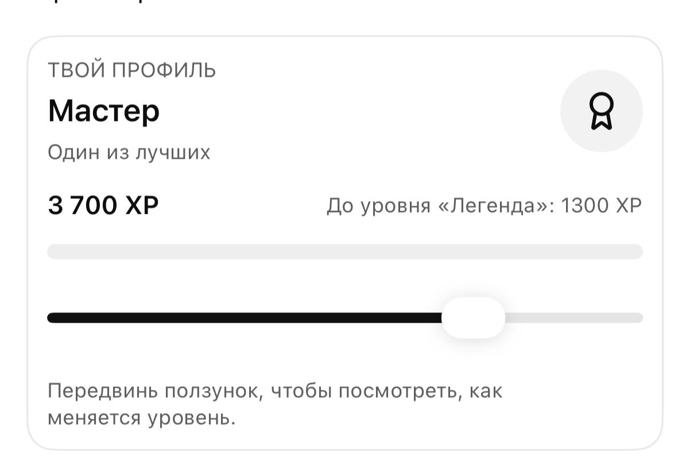
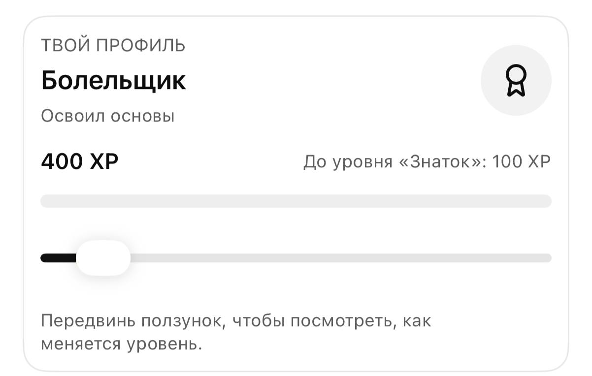
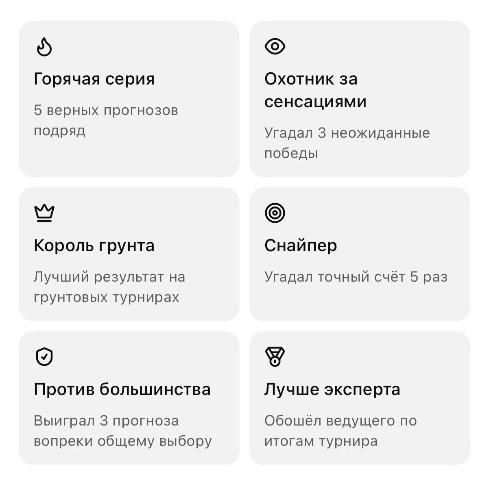

# Ответы владельца на план — 2026-10-13

- Вопрос ведущему, коллекционные карточки, уровни, бусты и звёзды канала — **в первый приоритет**.
- Для статистики берём ещё **Tennis Abstract**.
- Тестовая копия — **гораздо раньше** 1 ноября; **1 ноября — выход**.
- У каждого фэнтези **своя группа участников**; старые храним и помним, сколько человек участвовало;
  каждый новый драфт проходит заново.
- Бота владелец сделает, **когда будет готова первая база**.
- Ведущие: Мыскина, Авакова, Тартакова, Аношин, Знаменский, Володько, Кузнецов, Куклин, Донской, Сафина.
- Репозиторий: `RNGN-Home-of-Hockey/BOLSHE-Live-Center`.

## Макеты: профиль и уровни

Карточка «Твой профиль»: название уровня, подпись, текущий опыт (XP), сколько до следующего уровня,
полоса прогресса; ползунок «передвинь, чтобы посмотреть, как меняется уровень».

| Мастер — «Один из лучших», 3 700 XP, до «Легенды» 1 300 | Болельщик — «Освоил основы», 400 XP, до «Знатока» 100 |
|---|---|
|  |  |

Из макета: «Знаток» начинается с 500 XP, «Легенда» — с 5 000 XP.

## Макет: достижения

- Горячая серия — 5 верных прогнозов подряд
- Охотник за сенсациями — угадал 3 неожиданные победы
- Король грунта — лучший результат на грунтовых турнирах
- Снайпер — угадал точный счёт 5 раз (значит, в прогнозе есть точный счёт по сетам)
- Против большинства — выиграл 3 прогноза вопреки общему выбору
- Лучше эксперта — обошёл ведущего по итогам турнира

## Открытые вопросы

1. Полная лестница уровней: сколько уровней между «Болельщиком» и «Мастером», их названия и пороги XP.
2. Где лежит расписание теннисных эфиров «Больше» и кто комментирует (как Google-таблица у хоккея)?
3. Полные имена и фото ведущих, кто в каких рубриках.
4. Награды за бусты/звёзды и за таблицу прогнозистов — что именно дарим.
5. Правила фэнтези итоговых турниров (разводим одинаковые команды) — утвердить до ~25 октября.
